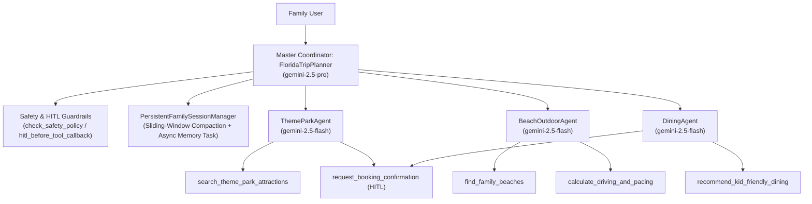

# 10-Day Florida Family Trip Planner (Google ADK in Python)

A production-ready Multi-Agent AI system built with the **Google Agent Development Kit (ADK)** in Python that helps families plan a balanced **10-day Florida vacation with kids** across Orlando theme parks (Walt Disney World, Universal Orlando, LEGOLAND, Kennedy Space Center), Gulf & Atlantic beaches (Clearwater Beach, Cocoa Beach), kid-friendly dining, and realistic driving pacing.

---

## Architecture & Rubric Alignment (AI in 5 Days Evaluation)



### 1. Tool & Interface Design ([`tools.py`](file:///usr/local/google/home/eyalmatz/florida-trip-planner/tools.py))
- **Descriptive, modular tools** with full docstrings (`Purpose`, `Args`, `Returns`):
  - `search_theme_park_attractions`: Filters Disney, Universal, LEGOLAND, and Kennedy Space Center attractions by youngest kid age and pacing style.
  - `find_family_beaches`: Recommends calm-water Gulf Coast (Clearwater, Fort De Soto) and Atlantic Coast (Cocoa Beach, Jetty Park) beaches with indoor rainy-day backups.
  - `recommend_kid_friendly_dining`: Finds allergy-aware, kid-appealing restaurants and character dining.
  - `calculate_driving_and_pacing`: Calculates drive times and kid-friendly highway pit-stops (e.g., Dinosaur World, Bonnet Springs Park).
  - `request_booking_confirmation`: Enforces a mandatory Human-in-the-Loop (`user_confirmed`) check before finalizing ticket purchases or dining reservations.
- **Explicit Pydantic Schemas**: All inputs and outputs are strictly validated via Pydantic models (`ThemeParkSearchInput`/`Output`, `BeachSearchInput`/`Output`, `DiningRecommendationInput`/`Output`, `DrivingRouteInput`/`Output`, `ReservationBookingInput`/`Output`).
- **Guided Error Recovery**: Invalid inputs or unrecognized destinations return `status="error"` along with a helpful `recovery_suggestion` guiding the LLM on valid arguments.

### 2. Context & Memory ([`agent.py`](file:///usr/local/google/home/eyalmatz/florida-trip-planner/agent.py))
- **Family Travel Concierge Constitution**: `FAMILY_CONCIERGE_CONSTITUTION` enforces the *Anti-Meltdown Rule* (max 2 consecutive theme park days, mandatory 1–4 PM nap/pool breaks, <2.5 hr drive legs, rainy-day backups, and child-safety guardrails).
- **Session Compaction & Persistence**: `PersistentFamilySessionManager` maintains a structured `family_profile`, compacts older turns into `compacted_summary` using a sliding window (`max_recent_turns`), and persists state to disk with PII redaction.
- **Asynchronous Background Memory Update**: `record_turn_and_schedule_memory_update` schedules an `asyncio` background task (`_async_extract_and_persist_memory`) to extract dietary needs, preferred parks, and beach preferences without blocking the main turn.

### 3. Orchestration & Logic ([`agent.py`](file:///usr/local/google/home/eyalmatz/florida-trip-planner/agent.py))
- **Multi-Agent Coordinator Pattern**:
  - `FloridaTripPlanner` (Master Coordinator)
  - `ThemeParkAgent` (Theme parks & attraction pacing)
  - `BeachOutdoorAgent` (Gulf/Atlantic beaches, weather & driving pacing)
  - `DiningAgent` (Kid-friendly dining, allergy protocols & reservations)
- **Strategic Model Routing**: Specialist sub-agents and tool lookups run on low-latency `gemini-2.5-flash`, while master 10-day itinerary synthesis runs on `gemini-2.5-pro`.
- **Safety & Human-in-the-Loop (HITL) Guardrails**: `check_safety_policy` blocks unsafe child/wildlife requests, and `request_booking_confirmation` / `hitl_before_tool_callback` halts bookings (`status="pending_human_confirmation"`) until `user_confirmed=True`.

### 4. Observability & Tracing ([`observability.py`](file:///usr/local/google/home/eyalmatz/florida-trip-planner/observability.py))
- **Structured JSON Logging**: `StructuredJsonFormatter` emits UTC timestamps, log levels, `event_type` (`INTENT` or `OUTCOME`), `agent_name`, and `metadata`.
- **Intent & Outcome Tracking**: Every tool and coordinator workflow logs both `INTENT` (before execution) and `OUTCOME` (status and duration in milliseconds).
- **OpenTelemetry Distributed Tracing**: `@traced_tool` and coordinator spans record execution metrics and attributes via OpenTelemetry (`TracerProvider`).
- **PII Redaction Utility**: `redact_pii` and `redact_dict` automatically mask credit card numbers (`[REDACTED_CC]`), phone numbers (`[REDACTED_PHONE]`), and emails (`[REDACTED_EMAIL]`) before logging or persisting session state.

### 5. Infrastructure & CI/CD
- **Automated Evaluation Suite**: [`tests/test_agent.py`](file:///usr/local/google/home/eyalmatz/florida-trip-planner/tests/test_agent.py) validates tool schemas, guided error recovery, session compaction, async memory updates, model routing, HITL hooks, PII redaction, OpenTelemetry spans, and secret injection.
- **Container & IaC Configuration**: Includes [`Dockerfile`](file:///usr/local/google/home/eyalmatz/florida-trip-planner/Dockerfile) and [`agent.yaml`](file:///usr/local/google/home/eyalmatz/florida-trip-planner/agent.yaml).
- **Secure Secret Injection**: Reads `GEMINI_API_KEY` exclusively from environment variables via `get_gemini_api_key()`.

---

## Quickstart & Usage

### 1. Install Dependencies
```bash
pip install -r requirements.txt
```

### 2. Configure Environment Secret
```bash
export GEMINI_API_KEY="your-gemini-api-key"
```

### 3. Run the 10-Day Itinerary Coordinator Demo
```bash
python3 agent.py
```

### 4. Run the Pytest Evaluation Suite
```bash
pytest -v tests/test_agent.py
```

### 5. Build & Run with Docker
```bash
docker build -t florida-trip-planner .
docker run --rm -e GEMINI_API_KEY="$GEMINI_API_KEY" florida-trip-planner
```
